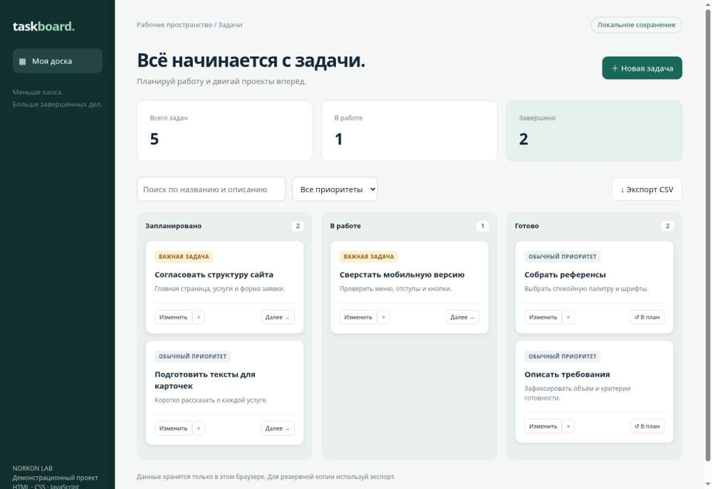

# TaskBoard

## Запуск
Откройте index.html в современном браузере. Интернет и установка библиотек не нужны. Если браузер ограничивает localStorage для локальных файлов, запустите из папки проекта `python -m http.server 8000` и откройте http://localhost:8000.

## Возможности
- Создание, редактирование, удаление задач с подтверждением.
- Три статуса, переключение кнопкой «Далее»; возврат готовой задачи в план.
- Поиск по названию и описанию, фильтр по приоритету.
- Счётчики отражают всю доску; количество в колонке отражает текущий фильтр.
- Сохранение в localStorage, экспорт всех задач в CSV для Excel.
- Адаптивный интерфейс, работа с клавиатуры, безопасный вывод пользовательского текста.

## Ограничения
Это локальный прототип: нет аккаунтов, сервера и совместной работы. Данные привязаны к браузеру и адресу страницы; очистка данных браузера удалит задачи. CSV является резервной выгрузкой, обратный импорт не реализован.

## Что показать заказчику
Создайте задачу, измените приоритет, переведите в работу, найдите поиском и выгрузите CSV. Обновите страницу, чтобы проверить сохранение.

Технологии: HTML5, CSS Grid, JavaScript, localStorage, Blob API.
